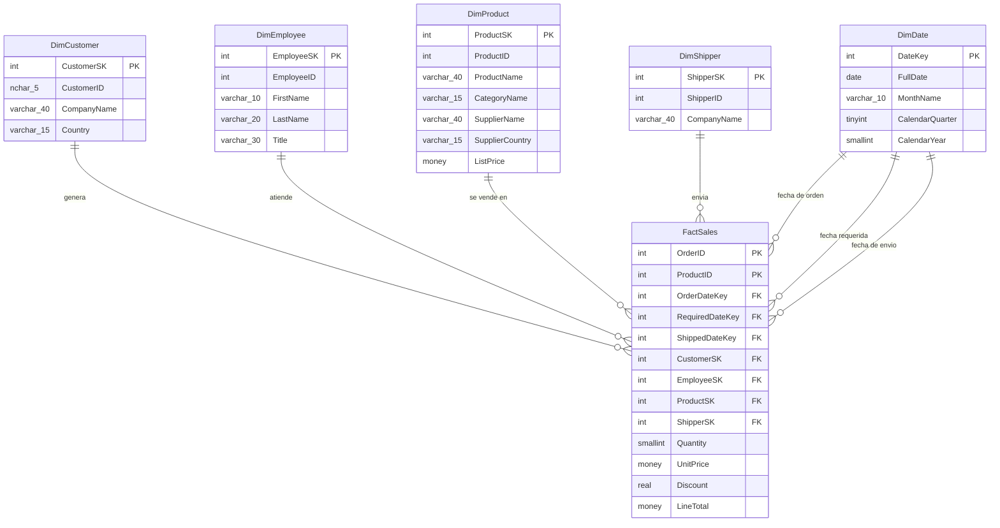

# Diagrama del modelo estrella — NorthWindDW

**Responsable:** Angel Christian Flores Lazarte

`FactSales` queda al centro, rodeada por sus cinco dimensiones — de ahí el
nombre "modelo estrella": visualmente, el diagrama tiene la forma de una
estrella con la tabla de hechos en el núcleo.

Nótese que `DimDate` se conecta tres veces a `FactSales` (una por cada
fecha de negocio de la orden), lo que en el diseño dimensional se conoce
como una dimensión de **rol múltiple**.
